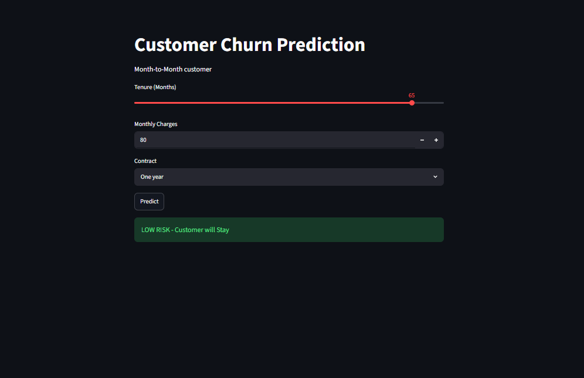
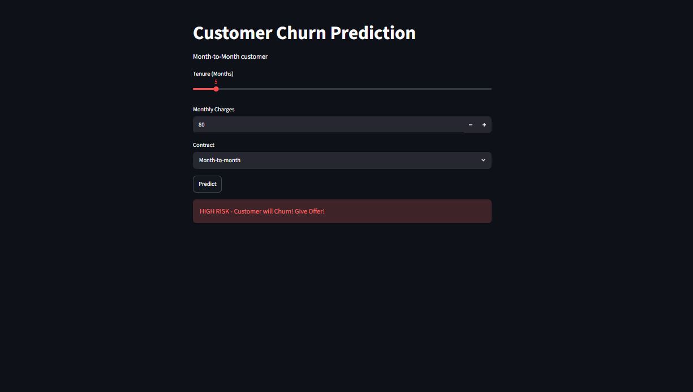
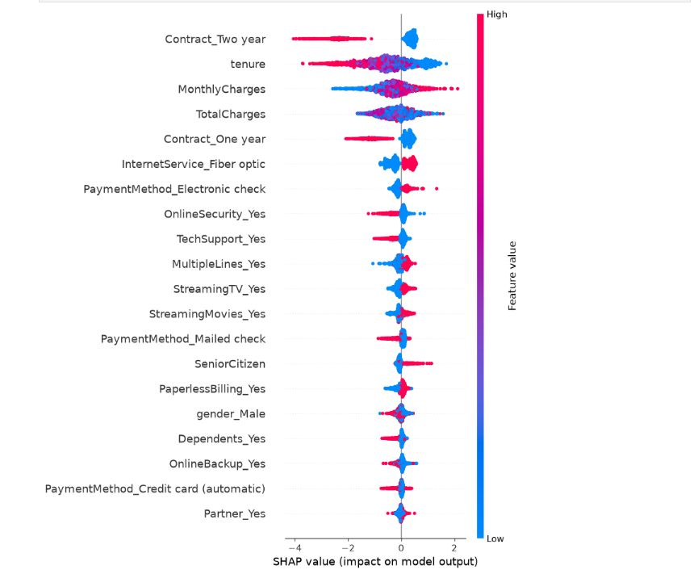

# Customer Churn Prediction 📉

Predict whether a telecom customer will leave (Churn) or stay, using Machine Learning.

Built with **XGBoost + SHAP + Streamlit**

---

## 🚀 Live Demo

| Low Risk - Customer will Stay | High Risk - Customer will Churn |
| :---: | :---: |
|  |  |

**Try it:**
- Tenure 65, Charges 80, Contract One year = **LOW RISK**
- Tenure 5, Charges 80, Contract Month-to-month = **HIGH RISK**

Monthly Charges are same in both cases, but Tenure and Contract changed the result. The model learned real business logic, not random guessing.

---

## 🧠 Why will a customer Churn? - SHAP Analysis



The model does not just predict, it explains why:

- **Contract_Two year:** Customers with a 2-year contract rarely churn
- **Tenure:** New customers with low tenure have high churn risk
- **MonthlyCharges:** Higher monthly bill increases churn risk
- **Contract_One year:** 1-year contract also reduces churn risk

---

## 📁 Files in this Repo

| File | Description |
| --- | --- |
| `app.py` | Streamlit App code |
| `churn-project.ipynb` | Full Project - EDA + Model Training + SHAP |
| `churn_model.pkl` | Trained XGBoost Model |
| `scaler.pkl` | Scaler for inputs |
| `low_risk.png` | App Screenshot - Low Risk |
| `high_risk.png` | App Screenshot - High Risk |
| `snap_plot.png` | SHAP Explanation Plot |

---

## 🛠️ How to Run Locally

```bash
pip install streamlit xgboost scikit-learn pandas
streamlit run app.py
